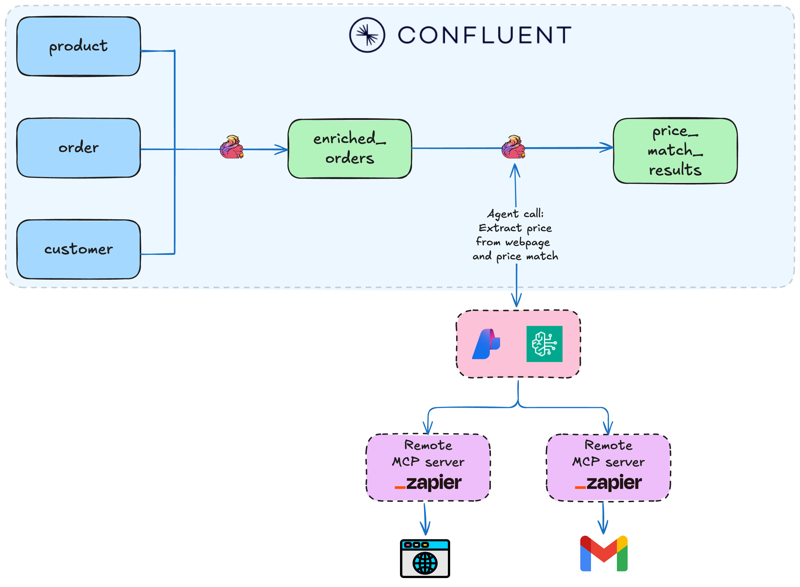
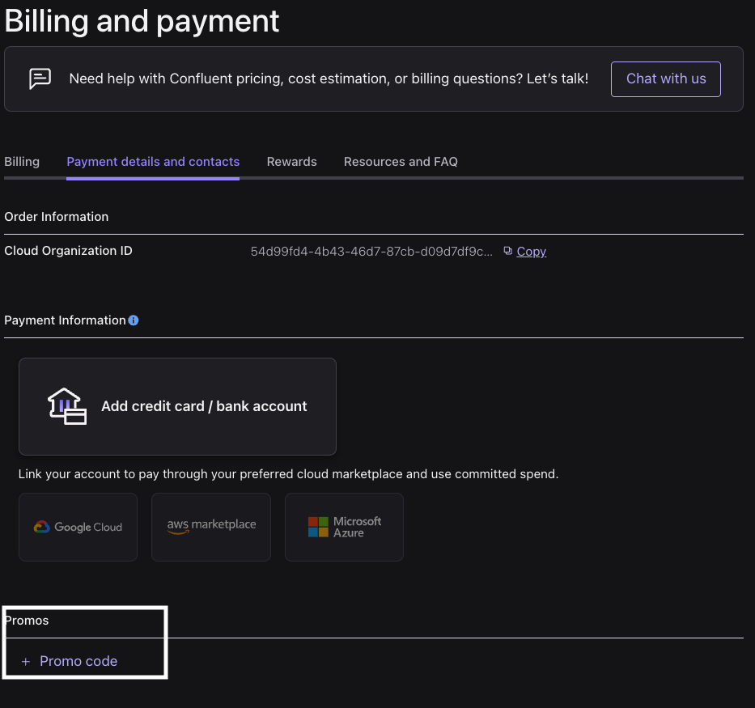
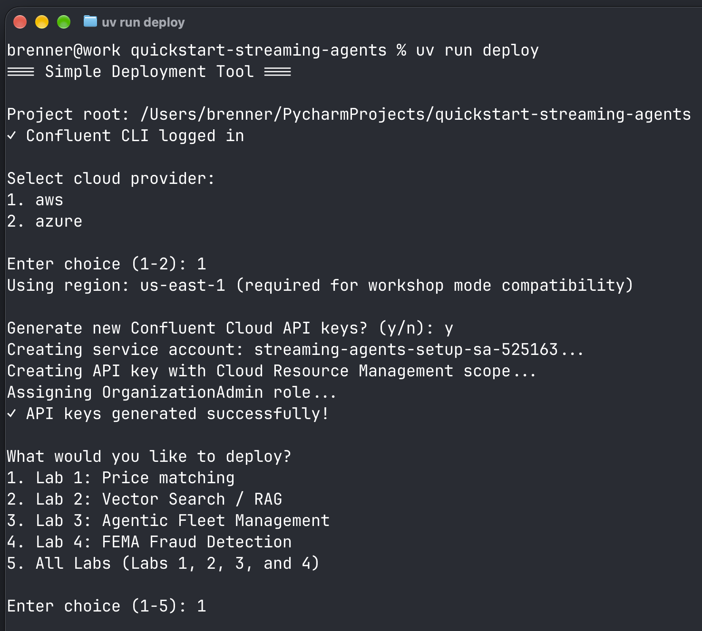
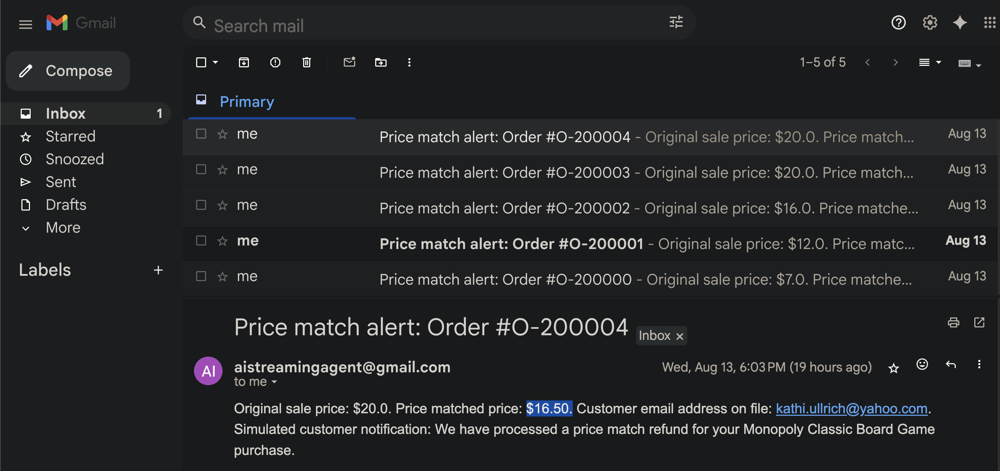

# Lab1: Price Matching Orders with MCP Tool Calling Agent Walkthrough

In this lab, we'll use Apache Flink for Confluent Cloud's MCP tool calling feature to "price match" customer orders in real-time. Flink, through tool calling, uses a remote MCP server to retrieve competitor prices, and if a competitor offers a better price, the agent automatically applies a price match and uses tool calling again to email the customer a summary.



## Prerequisites

> [!TIP]
> **TechXChange attendee, or provided a workstation by the workshop host?** Skip the local dependencies and API keys below — they're already set up for you. Start with **Add a payment method or promo code**, then continue to [Deploy the Demo](#deploy-the-demo).

### Add a payment method or promo code

A payment method or promo code is required in Confluent Cloud so Terraform can create your cluster. Free credit is used first, so you typically won't be charged during the workshop.

1. Go directly to **[Billing & payment](https://confluent.cloud/settings/billing/payment)**.
2. Open the **Payment details and contacts** tab.
3. Choose **one** of the two options:

   - **Option A — Credit card:** click **Add credit card / bank account**, enter your **card details**, then **Save**.
   - **Option B — Promo code (provided by the workshop host):** scroll down to **Promos**, click **+ Promo code**, enter the code you were given, then **Apply**. No credit card is needed.

   

<details>
<summary><strong>Prerequisites for your own machine</strong> — skip if you are a TechXChange attendee or were given a workstation (click to expand)</summary>

### Local dependencies

**Installation instructions:**

```bash
brew install uv git python && brew tap hashicorp/tap && brew install hashicorp/tap/terraform && brew install --cask confluent-cli
```
**Windows:**

```powershell
winget install astral-sh.uv Git.Git Hashicorp.Terraform ConfluentInc.Confluent-CLI Python.Python
```

### API keys & access

> [!NOTE]
>
> The credentials below are not required in instructor-led workshops — they will be provided for you.

- **LLM Access:** AWS Bedrock API keys **OR** Azure OpenAI endpoint + API key
  - No AWS/Azure account required - just the LLM API credentials!
  - **Easy key creation:** Run `uv run api-keys create` to quickly generate ready-to-use credentials

> [!WARNING]
>
> **AWS Bedrock Users:** You must request access to Claude Sonnet 4.5 by filling out an Anthropic use case form. Visit the [Model Catalog](https://console.aws.amazon.com/bedrock/home#/model-catalog), select Claude Sonnet 4.5, open it in the Playground, and send a message - the form will appear automatically.

- **Remote MCP server backend:** Lab 1 calls a remote MCP server for HTTP fetch and email send. `uv run deploy` will prompt you to choose:
  - **Confluent-hosted remote MCP server (Recommended)** — No setup on your end; obtain a token by asking your presenter, or, if you're a Confluent employee, see `go/mcp-keys` or `#help-tmm`.
  - **Zapier** — a third-party MCP server. See [Zapier-Setup.md](./assets/pre-setup/Zapier-Setup.md) for setup. Prefer the Confluent-hosted remote MCP server for workshops.

  To switch backends after deploying, run `uv run destroy` first, then re-deploy.

</details>

## Deploy the Demo

1. Open a **Terminal** on your machine — click **Activities** (top-left), then the **Terminal** icon in the dock.

   

2. Go to the workshop folder and pull the latest changes:

   ```bash
   cd workshop/4547/
   git pull
   ```

   <details>
   <summary><strong>Using your own machine?</strong> Clone the repo instead</summary>

   ```bash
   git clone https://github.com/confluentinc/quickstart-streaming-agents.git
   cd quickstart-streaming-agents
   ```

   </details>

3. Run the following command and choose **Lab1** (see [main README](./README.md)):

   ```bash
   uv run deploy
   ```

   

   `uv run deploy` prompts for the following:

   | Prompt | Where to get it |
   |---|---|
   | Confluent Cloud email / password | The **email and password you used to sign up** (press Enter to skip if you use SSO, then run `confluent login --sso`) |
   | Select cloud provider | `aws` |
   | Generate new Confluent Cloud API keys? | Answer `y` — `uv` creates the API key and secret for you |
   | What would you like to deploy? | **Lab 1: Price matching** |
   | Remote MCP server backend | **Confluent-hosted remote MCP server (Recommended)** |
   | Confluent Cloud API Key / Secret | Press **Enter** to confirm the key and secret `uv` just created |
   | AWS Bedrock Access Key / Secret Key | The AWS Bedrock key your instructor gave you (or one from `uv run api-keys create`) |
   | MCP token | The token your presenter gave you |
   | Email address for Lab 1 price-match notifications | Press **Enter** to use your Confluent Cloud email (or enter another email where you can check your inbox during the lab) — `uv` automatically fills it into the SQL queries below |

# Getting Started

## 1. Test the LLM models before continuing

Once you've deployed Lab1, open the [SQL Workspace](https://confluent.cloud/go/flink), select your Confluent Cloud environment, and run the following queries to make sure your models are working as expected:

#### Test Query 1: Base LLM model

```sql
SELECT
  question,
  response
FROM (SELECT 'How was the state of Colorado founded?' as question) t,
LATERAL TABLE(ML_PREDICT('llm_textgen_model', question, MAP['debug', 'true'])) as r(response);
```

#### Test Query 2: LLM Tool Calling Model

> [!NOTE]
>
> `uv run deploy` automatically fills your email address into the query below. If you still see `<<YOUR-EMAIL-ADDRESS-HERE>>`, replace it with your email address (do **not** add extra single quotes around it).

```sql
 SELECT
      AI_TOOL_INVOKE(
          'remote_mcp_model',
          'Use the send_email tool to send an email. 
           The "to" parameter must be a single string value: <<YOUR-EMAIL-ADDRESS-HERE>>
           The "subject" parameter is: Direct Query Test
           The "body" parameter is: This email was sent directly from Confluent Cloud!
           Important: pass the to address as a string, not an array.',
          MAP[],
          MAP['send_email', 'Send an email via Gmail SMTP'],
          MAP['debug', 'true']
      ) as response;
```

## 2. Generate Data

Begin generating data with the following command:

```bash
uv run lab1_datagen --local
```

> [!NOTE]
>
> Keep this command running in your terminal — it produces one order every 2 minutes. Proceed with the lab while it runs.

The data generator creates three typical ecommerce data streams:

- **`customers`**: 100 customer records with realistic names, emails, addresses, and state information
- **`products`**: 17 product records including electronics, games, sports equipment, and household items with prices ranging from $5-$365
- **`orders`**: Continuous stream of orders linking customers to products with timestamps

## Run SQL Queries

## 3. Create `enriched_orders` table for the agent to use

Enrich the incoming orders stream with customer and product details.
We’ll use regular joins for this step and configure a state TTL to prevent the state from growing indefinitely.

```sql
SET 'sql.state-ttl' = '1 HOURS';

CREATE TABLE enriched_orders AS
SELECT
    o.order_id,
    p.product_name,
    c.customer_email,
    o.price AS order_price
FROM orders o
JOIN customers c ON o.customer_id = c.customer_id
JOIN products p ON o.product_id = p.product_id;
```

> NOTE: Leave the query running so that it runs continously.

### 4. Run  `CREATE TOOL` and `CREATE AGENT`

The agent will use the [Tool Calling](https://docs.confluent.io/cloud/current/ai/builtin-functions/invoke-tool-ai-workflow.html) feature to scrape competitors’ websites, extract the price of the same product, and send an email when a price match is found.
Create a new tool that leverages the remote MCP connection:

```sql
CREATE TOOL lab1_remote_mcp
USING CONNECTION `remote-mcp-connection`
WITH (
  'type' = 'mcp',
  'allowed_tools' = 'http_get, send_email',
  'request_timeout' = '30'
);
```

Next, create a new agent and provide a **system prompt**.  
This agent will compare the extracted competitor price with our own product price and determine whether to trigger a price match and send an email notification.


```sql
CREATE AGENT price_match_agent
USING MODEL remote_mcp_model
USING PROMPT 'You are a price matching assistant that performs the following steps:

1. SCRAPE COMPETITOR PRICE: Use the http_get tool to extract page contents from the competitor URL provided in the prompt.

2. EXTRACT PRICE: Analyze the scraped page content to find the product that most closely matches the product name. Extract only the price in format: XX.XX (for example: 29.95). If you cannot find a valid price, stop here.

3. COMPARE AND NOTIFY: Compare the extracted competitor price with our order price. If the competitor price is lower than our price, use the send_email tool to send a price match notification email. Use the exact format provided in the prompt for the email subject and body.

Return your results in this exact format:

Competitor Price:
[price as XX.XX, or "Not found"]

Decision:
[PRICE_MATCH or NO_MATCH]

Summary:
[One sentence describing what you found and what action you took]'
USING TOOLS lab1_remote_mcp
COMMENT 'Consolidated agent for scraping competitor prices and sending price match notifications'
WITH (
  'max_consecutive_failures' = '2',
  'MAX_ITERATIONS' = '10'
);
```

## 5. Run the Agent

The agent will take `enriched_orders` as input and process each order in real time as it is generated.  
To run the agent continuously, we’ll execute it as part of a **Flink job**.  
Provide a **user prompt** to guide how the agent processes each incoming enriched order, and create a new table named `price_match_results` to store the agent’s evaluation results.

> [!NOTE]
>
> `uv run deploy` automatically fills your email address into the `EMAIL RECIPIENT:` line below. If you still see `<<YOUR-EMAIL-ADDRESS-HERE>>`, replace it with your email address (do **not** add extra single quotes around it).


```sql
CREATE TABLE price_match_results AS
SELECT
    pmi.order_id,
    pmi.product_name,
    pmi.customer_email,
    CAST(CAST(pmi.order_price AS DECIMAL(10, 2)) AS STRING) as order_price,
    agent_result.status as agent_status,
    TRIM(REGEXP_EXTRACT(CAST(agent_result.response AS STRING), '\*{0,2}Competitor Price:\*{0,2}\s*\n?([\s\S]+?)(?=\n\*{0,2}(?:Decision|Summary):|$)', 1)) AS competitor_price,
    TRIM(REGEXP_EXTRACT(CAST(agent_result.response AS STRING), '\*{0,2}Decision:\*{0,2}\s*\n?([A-Z_]+)', 1)) AS decision,
    TRIM(REGEXP_EXTRACT(CAST(agent_result.response AS STRING), '\*{0,2}Summary:\*{0,2}\s*\n?([\s\S]+?)$', 1)) AS summary,
    CAST(agent_result.response AS STRING) AS raw_response
FROM enriched_orders pmi,
LATERAL TABLE(
    AI_RUN_AGENT(
        'price_match_agent',
         CONCAT(
          'COMPETITOR URL: http://river-retail-resellers.s3-website-us-east-1.amazonaws.com/',
          '
          PRODUCT NAME: ', pmi.product_name, '
          
          OUR ORDER PRICE: $', CAST(CAST(pmi.order_price AS DECIMAL(10, 2)) AS STRING), '
          
          EMAIL RECIPIENT: <<YOUR-EMAIL-ADDRESS-HERE>>
          
          EMAIL SUBJECT: ✅ Great News! Price Match Applied - Order #', pmi.order_id, '
          
          EMAIL BODY TEMPLATE:
          Subject: Your Price Match Has Been Applied - Order #', pmi.order_id, '
          
          Dear Valued Customer,
          
          We have great news! We found a better price for your recent purchase and have automatically applied a price match.
          
          📦 ORDER DETAILS:
             • Order Number: #', pmi.order_id, '
             • Product: ', pmi.product_name, '
          
          💰 PRICE MATCH DETAILS:
             • Original Price: $', CAST(CAST(pmi.order_price AS DECIMAL(10, 2)) AS STRING), '
             • Competitor Price Found: $[INSERT_COMPETITOR_PRICE]
             • Your Savings: $[INSERT_SAVINGS]
          
          ✅ ACTION TAKEN:
          We have processed a price match refund of $[INSERT_SAVINGS] back to your original payment method. You should see this credit within 3-5 business days.
          
          🛒 WHY WE DO THIS:
          We are committed to offering you the best prices. Our automated price matching system continuously monitors competitor prices to ensure you always get the best deal.
          
          Thank you for choosing River Retail. We appreciate your business!
          
          Best regards,
          River Retail Customer Success Team
          📧 support@riverretail.com | 📞 1-800-RIVER-HELP
          
          ---
          This is an automated message from our price matching system.'
        ),
        pmi.order_id,
        MAP['debug', 'true']
    )
) as agent_result(status, response);
```

Our real-time price matching pipeline is complete—orders stream in, competitor prices are fetched and analyzed, and customers are instantly notified when they get the best deal.

View the final table:
```sql
SELECT * FROM `price_match_results`
```

Then check out your email for price matched orders:

<details open>
<summary>Click to collapse</summary>


</details>

## Troubleshooting
<details>
<summary>Click to expand</summary>

- **Not getting emails?**
  - Ensure `<<YOUR-EMAIL-ADDRESS-HERE>>` in both Test Query 2 and the `CREATE TABLE price_match_results` query has been replaced with your email address (`uv run deploy` does this automatically). Do **not** wrap the email address in extra single quotes, as it is already inside a single-quoted SQL string.
  - **Run the MCP test query** (Test Query 2) to confirm the `remote-mcp-connection` is working and able to send emails.
  - **Check remote MCP server logs** in CloudWatch (`/aws/lambda/remote-mcp-server-MCPFunction-*`) for errors from the `send_email` tool.
  - **Make sure to run `uv run lab1_datagen --local`** to begin producing orders data.
- **Need to restart data generation?**
  - Simply re-run `uv run lab1_datagen --local`. It automatically purges any existing records in `customers`, `products`, and `orders` before publishing fresh data (do **not** drop the `orders`, `customers`, or `products` tables in Flink, as those tables were created by Terraform).

- `Runtime received bad response code 403. Please also double check if your model has multiple versions.` error?
  - **AWS?** Ensure you've activated Claude Sonnet 4.5 in your AWS account. See: [Prerequisites](#prerequisites)
  - **Azure?** Increase the tokens per minute quota for your GPT-4 model. Quota is low by default.

- `MCP error -32602: Invalid arguments for tool send_email` error?
  - Make sure your email address is plain text inside the prompt (a plain address after `EMAIL RECIPIENT:`, without extra quotes or brackets).
  - Modify the model prompt to be more prescriptive about what format you need the email in (string, not array).

- **`remote-mcp-connection` not found after `terraform apply`?**
  - The connection is created via Confluent CLI in a `local-exec` provisioner. Check that `confluent` CLI is installed and `CONFLUENT_CLOUD_API_KEY`/`CONFLUENT_CLOUD_API_SECRET` are set, then re-run `terraform apply`.
  </details>

## Navigation

- **← Back to Overview**: [Main README](./README.md)
- **→ Next Lab**: [Lab2: Vector Search / RAG](./LAB2-Walkthrough.md)
- **Cleanup**: [Cleanup Instructions](./README.md#cleanup)
