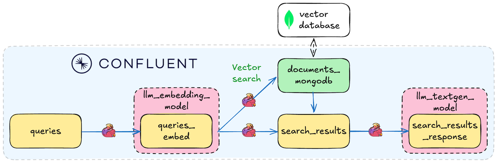

# Lab 2: Vector Search / RAG

Ask questions against a preloaded knowledge base of Confluent Flink documentation. Flink embeds each question, retrieves matching passages from MongoDB Atlas, and uses a text-generation model to answer from those passages.



> [!TIP]
> **Already deployed Lab 2?** Skip to [Using the RAG Pipeline](#using-the-rag-pipeline). The documents and vector index are already loaded; you do not need to publish documents or configure a sink connector.

## Prerequisites

- **Models:** `uv run deploy` uses Confluent-hosted inference by default: Claude Sonnet 4.6 and Titan Text Embeddings v2 on AWS; GPT-5.4 mini and text-embedding-3-small on Azure. No separate cloud account or LLM API key is needed.
- **Optional model credentials:** Use `uv run deploy --bedrock` or `uv run deploy --azure-openai` to bring your own credentials. See the [Workshop Mode Setup Guide](./assets/pre-setup/Workshop-Mode-Setup.md). For Bedrock, complete the Claude Sonnet 4.5 use-case form in the [Model Catalog](https://console.aws.amazon.com/bedrock/home#/model-catalog) by opening its Playground and sending a test message.
- **MongoDB Atlas:** The shared corpus and vector index are preconfigured. Deployment connects the lab to them.

## Deployment

If needed, clone the repository and deploy **Lab 2**:

```bash
git clone https://github.com/confluentinc/quickstart-streaming-agents.git
cd quickstart-streaming-agents
uv run deploy
```

Deployment creates the query pipeline using these five tables:

| Table | Purpose |
|---|---|
| `queries` | Questions published from your terminal |
| `queries_embed` | Questions with vector embeddings |
| `documents_vectordb_lab2` | External table over the preloaded MongoDB vector index |
| `search_results` | Retrieved document chunks and similarity scores |
| `search_results_response` | Questions, retrieved sources, and generated answers |

The two shared models are `llm_embedding_model` and `llm_textgen_model`. The deployed pipeline does not create `documents`, `documents_embed`, or a MongoDB sink connector.

## Using the RAG Pipeline

### 1. Check the workspace and background jobs

Open [Flink](https://confluent.cloud/go/flink). Select the **environment/catalog**, **Kafka cluster/database**, and **compute pool** from your deployment summary before opening a SQL workspace.

In the statement list, confirm these background writers are `RUNNING`:

- `queries-embed-insert-into`
- `search-results-create-table`
- `search-results-response-create-table`

They perform embedding, vector retrieval, and answer generation. Deployment also publishes a sample question, so existing rows alone do not prove your new question completed.

### 2. Publish a question

From your terminal:

```bash
uv run publish_queries "How do window functions work in Flink SQL?"
```

Or prompt for one question:

```bash
uv run publish_queries
```

The prompt accepts one question, publishes it, and exits. Run the command again to ask another. If cloud-provider detection is ambiguous, supply it explicitly:

```bash
uv run publish_queries aws "How do window functions work in Flink SQL?"
```

Use `azure` instead of `aws` for an Azure deployment. Questions move asynchronously through `queries` → `queries_embed` → `search_results` → `search_results_response`; model latency and shared compute affect how soon the answer appears.

### 3. Inspect the retrieved evidence

Run each SQL block in a separate cell. Match the filter to the exact question you published; double any apostrophe inside the SQL string.

```sql
SELECT query, document_id_1, chunk_1, score_1
FROM search_results
WHERE query = 'How do window functions work in Flink SQL?';
```

Expect a document ID, a nonempty passage, and a similarity score. The table also contains the second and third matches (`document_id_2` / `chunk_2` / `score_2` and corresponding `_3` fields). Open the passage to check that it supports the answer.

**Stop this SELECT after inspection**, then open the next cell. Preview queries hold compute while they remain running.

### 4. Read the answer

```sql
SELECT query, response
FROM search_results_response
WHERE query = 'How do window functions work in Flink SQL?';
```

Confirm that your exact question has a nonempty answer and compare it with the retrieved passages. Answers may cite “Document 1/2/3”; use the corresponding `document_id` and chunk columns in `search_results` to verify the underlying passage.


*Audited example, not a console screenshot. Generated answers and retrieval scores can vary.*

**Stop the answer SELECT when finished.** Leave the three deployed writer statements running if you plan to ask more questions.

## Troubleshooting

- **No answer yet:** Check that the question reached `queries`, then inspect `queries_embed` and `search_results` to find the stage that has not produced output. Allow time for inference and check all three background writers.
- **`PENDING` / `POOL_EXHAUSTED`:** Stop preview SELECTs and completed-lab jobs you no longer need. Check the statement's capacity status before treating a blank results pane as missing data.
- **Embedding or text-generation errors:** Run `SHOW MODELS;` in the selected database and inspect the failed writer's exceptions. [Lab 1 Test Query 1](./LAB1-Walkthrough.md#test-query-1-base-llm-model) tests text generation. For native hosted inference, follow the reported model-access/quota error; optional Bedrock/Azure credentials apply only when you deployed with those modes.
- **Retrieval empty or failing:** Inspect the external table and MongoDB connection/index error on `search-results-create-table`. There is no MongoDB sink connector to restart in this lab.
- **Published successfully, but seeing an old answer:** Filter by the exact question instead of reading the first five rows. Repeating identical question text can produce multiple rows; this lab has no per-request correlation ID.

## Moving on and cleanup

Stop your preview SELECTs. If you no longer need Lab 2 processing, stop its three writer statements too; retained tables and results remain available. Resume those writers before publishing more questions.

`uv run destroy` removes **all deployed labs and shared core resources**. Run it only after finishing all chosen labs.

## Navigation

- [Back to overview](./README.md)
- [Previous: Lab 1 — Tool Calling](./LAB1-Walkthrough.md)
- [Next: Lab 3 — Agentic Fleet Management](./LAB3-Walkthrough.md)
- [Full quickstart cleanup](./README.md#cleanup)
