# Lab3: Agentic Fleet Management Using Confluent Intelligence
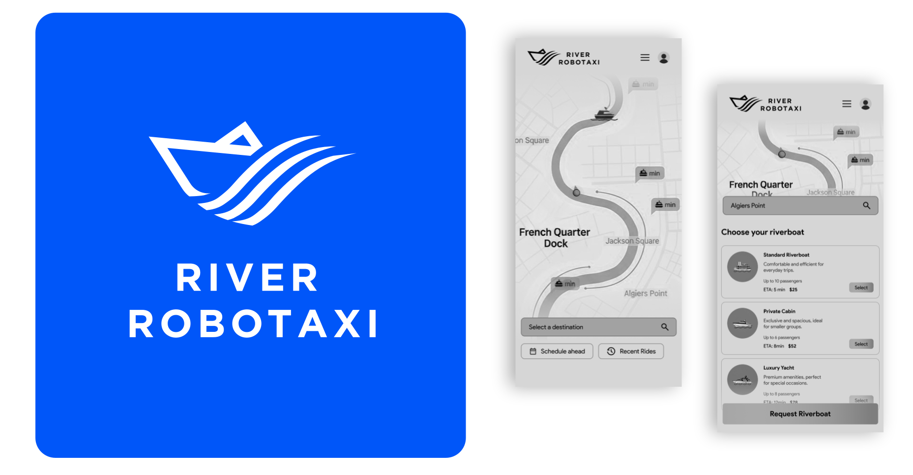

This lab builds an event-driven fleet management pipeline on [Confluent Intelligence](https://www.confluent.io/product/confluent-intelligence/) and **Confluent Cloud for Apache Flink** with no external orchestration:

1. **Anomaly Detection** – Detects pickup-zone ride demand spikes in 5-minute windows with Flink's [built-in ML functions](https://docs.confluent.io/cloud/current/ai/builtin-functions/overview.html).
2. **Contextual Understanding** – Uses [vector search](https://docs.confluent.io/cloud/current/ai/external-tables/vector-search.html) and RAG over local event data to suggest a likely cause or state that the cause is uncertain.
3. **Autonomous Action** – Uses [Streaming Agents](https://docs.confluent.io/cloud/current/ai/streaming-agents/overview.html) with MCP tool calling to inspect fleet status and dispatch vessels.

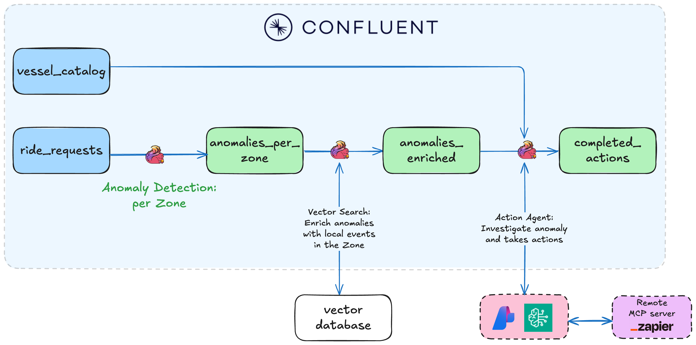

## Prerequisites

### Local dependencies

**macOS:**

```bash
brew install uv git python && brew tap hashicorp/tap && brew install hashicorp/tap/terraform && brew install --cask confluent-cli
```

**Windows:**

```powershell
winget install astral-sh.uv Git.Git Hashicorp.Terraform ConfluentInc.Confluent-CLI Python.Python
```

### API keys & access

> [!NOTE]
> Workshop attendees do not need cloud LLM credentials—instructor-led environments provide required access.

- **LLM Access (No keys required by default):** `uv run deploy` uses **CSP Hosted model inference** (AWS: Claude Sonnet 4.6 + Titan Text Embeddings v2; Azure: GPT-5.4 mini + text-embedding-3-small).
  - **Optional self-managed keys:** Run `uv run deploy --bedrock` or `uv run deploy --azure-openai` (use `uv run api-keys create` or see [Workshop Mode Setup Guide](./assets/pre-setup/Workshop-Mode-Setup.md)).
  - **`--bedrock` users:** Before running queries, enable **Claude Sonnet 4.5** in the [AWS Bedrock Model Catalog](https://console.aws.amazon.com/bedrock/home#/model-catalog) by opening it in the Playground and submitting the Anthropic use-case form.
- **Remote MCP server backend:** Lab 3 uses a remote MCP server for HTTP vessel catalog lookups and dispatch calls. Choose your backend **before** deploying (if you need to change backends on an existing environment, contact your instructor rather than running a full destroy):
  - **Confluent-hosted remote MCP server (Recommended):** Obtain a token from your presenter (Confluent staff: see `go/mcp-keys` or `#help-tmm`).
  - **Zapier:** Third-party option; see [Zapier-Setup.md](./assets/pre-setup/Zapier-Setup.md).

## Deploy and Data Generation

> [!TIP]
> **Already deployed?** If you deployed earlier (for example in Lab 1/Lab 2) and your Lab 3 data replay is already running or completed, **skip this section** and go straight to [Step 1](#1-detect-surges-with-ml_detect_anomalies).

Clone and update the repository:

```bash
git clone https://github.com/confluentinc/quickstart-streaming-agents.git
cd quickstart-streaming-agents
```

```bash
git pull
```

Deploy and select **Lab3**:

```bash
uv run deploy
```

### Load `ride_requests` data

Run the local replay publisher once:

```bash
uv run lab3_datagen --local
```

- **How `--local` works:** It purges `ride_requests`, replays about 24 hours of historical ride requests (30,729 records in the audited dataset), advances the event-time watermark, and then exits. You do **not** wait 24 wall-clock hours.
- **Do not re-run casually:** Because `--local` purges `ride_requests` before replaying, re-running it while downstream agents are active can re-trigger dispatches. To resume normal work, reuse your existing Flink tables and statements. If you ever need a full state reset, stop the three Lab 3 continuous writers (`completed_actions`, `anomalies_enriched`, `anomalies_per_zone`) first and check with your instructor.

## Walkthrough

Allow several minutes for the replay, anomaly training and inference. Continue only after each output checkpoint succeeds; a RUNNING status alone does not confirm output.

### Open the Flink SQL Workspace

1. Open [Confluent Cloud Flink](https://confluent.cloud/go/flink), select the **environment** from your deployment summary, and open a **SQL Workspace**.
2. In the workspace selectors, choose the exact **Catalog** (environment), **Database** (Kafka cluster), and **Compute Pool** printed by `uv run deploy` (never hardcode someone else's suffix).
3. Run a preflight check:

Run each check in its own cell:

```sql
SHOW TABLES;
```

```sql
SHOW MODELS;
```

Confirm tables `ride_requests` and `documents_vectordb_lab3` and models `llm_textgen_model`, `llm_embedding_model`, and `remote_mcp_model` exist.

> [!IMPORTANT]
> **`SET` statements in Flink Console:** A `SET` statement cannot execute by itself in a cell. Always keep any leading `SET 'sql.local-time-zone' = 'America/Chicago';` in the **same cell** as the `SELECT` or `CREATE TABLE` query beneath it.

### 1. Detect surges with `ML_DETECT_ANOMALIES`

Flink's [anomaly detection function](https://docs.confluent.io/cloud/current/ai/builtin-functions/detect-anomalies.html) ([SQL reference](https://docs.confluent.io/cloud/current/flink/reference/functions/model-inference-functions.html#flink-sql-ml-anomaly-detect-function)) groups `ride_requests` into 5-minute tumbling windows per `pickup_zone`. With `minTrainingSize = 286` (~23h 50m of 5-minute buckets per zone) and `confidencePercentage = 99.9`, the preloaded replay supplies the training history. Allow time for Flink to process it; you do not need to wait a day for new observations.

First, run this **disposable preview query** to inspect the anomaly chart:

```sql
SET 'sql.local-time-zone' = 'America/Chicago';

WITH windowed_traffic AS (
    SELECT
        window_start,
        window_end,
        window_time,
        pickup_zone,
        COUNT(*) AS request_count,
        SUM(number_of_passengers) AS total_passengers,
        SUM(CAST(price AS DECIMAL(10, 2))) AS total_revenue
    FROM TABLE(
        TUMBLE(TABLE ride_requests, DESCRIPTOR(request_ts), INTERVAL '5' MINUTE)
    )
    GROUP BY window_start, window_end, window_time, pickup_zone
)
SELECT
    pickup_zone,
    window_time,
    request_count,
    total_passengers,
    total_revenue,
    ML_DETECT_ANOMALIES(
        CAST(request_count AS DOUBLE),
        window_time,
        JSON_OBJECT(
            'minTrainingSize' VALUE 286,
            'maxTrainingSize' VALUE 7000,
            'confidencePercentage' VALUE 99.9,
            'enableStl' VALUE FALSE
        )
    ) OVER (
        PARTITION BY pickup_zone
        ORDER BY window_time
        RANGE BETWEEN UNBOUNDED PRECEDING AND CURRENT ROW
    ) AS anomaly_result
FROM windowed_traffic;
```

Click **anomaly_result** in the results pane to view the chart:

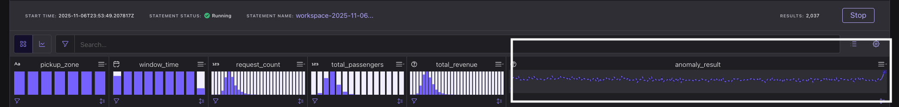

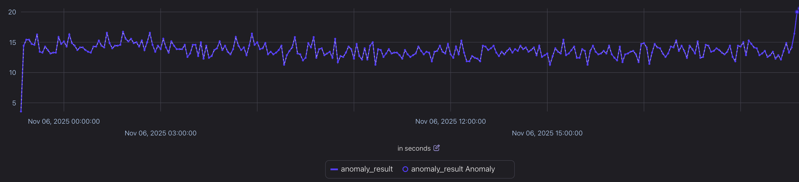

**Stop this preview query** once you have inspected the chart so it does not hold compute resources.

Next, start the **persistent continuous job** that writes detected surges to `anomalies_per_zone` (also using `99.9` confidence):

```sql
SET 'sql.local-time-zone' = 'America/Chicago';

CREATE TABLE anomalies_per_zone AS
WITH windowed_traffic AS (
    SELECT
        window_start,
        window_end,
        window_time,
        pickup_zone,
        COUNT(*) AS request_count,
        SUM(number_of_passengers) AS total_passengers,
        SUM(CAST(price AS DECIMAL(10, 2))) AS total_revenue
    FROM TABLE(
        TUMBLE(TABLE ride_requests, DESCRIPTOR(request_ts), INTERVAL '5' MINUTE)
    )
    GROUP BY window_start, window_end, window_time, pickup_zone
),
anomaly_detection AS (
    SELECT
        pickup_zone,
        window_time,
        request_count,
        total_passengers,
        total_revenue,
        ML_DETECT_ANOMALIES(
            CAST(request_count AS DOUBLE),
            window_time,
            JSON_OBJECT(
                'minTrainingSize' VALUE 286,
                'maxTrainingSize' VALUE 7000,
                'confidencePercentage' VALUE 99.9,
                'enableStl' VALUE FALSE
            )
        ) OVER (
            PARTITION BY pickup_zone
            ORDER BY window_time
            RANGE BETWEEN UNBOUNDED PRECEDING AND CURRENT ROW
        ) AS anomaly_result
    FROM windowed_traffic
)
SELECT
    pickup_zone,
    window_time,
    request_count,
    total_passengers,
    total_revenue,
    CAST(ROUND(anomaly_result.forecast_value) AS BIGINT) AS expected_requests,
    anomaly_result.upper_bound AS upper_bound,
    anomaly_result.lower_bound AS lower_bound,
    anomaly_result.is_anomaly AS is_surge
FROM anomaly_detection
WHERE anomaly_result.is_anomaly = true
  AND request_count > anomaly_result.upper_bound;
```

**Keep `CREATE TABLE anomalies_per_zone` running** through the rest of Lab 3.

In a new cell, preview the output table:

```sql
SET 'sql.local-time-zone' = 'America/Chicago';

SELECT * FROM anomalies_per_zone
```

You should see a `French Quarter` surge (for example, `61` actual requests vs. `~12` expected; exact rows can vary dynamically). **Stop the `SELECT` preview** after verifying.

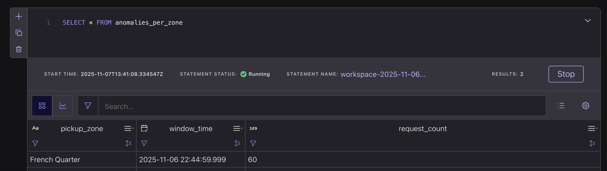

### 2. Enrich `anomalies_per_zone` with vector search & RAG

Next, enrich each surge with likely causes. Using named CTEs, the query formats a single local-dated search string (`America/Chicago`), embeds it with `llm_embedding_model`, retrieves the top 3 matching chunks from `documents_vectordb_lab3`, and prompts `llm_textgen_model` to summarize the cause—or state uncertainty rather than fabricating details if no overlapping event exists.

Run and **keep this continuous `CREATE TABLE anomalies_enriched` job running**:

```sql
SET 'sql.local-time-zone' = 'America/Chicago';

CREATE TABLE anomalies_enriched
WITH ('changelog.mode' = 'append') AS
WITH surge_queries AS (
    SELECT
        pickup_zone, window_time, request_count, expected_requests,
        CONCAT(
            'Transportation demand surge in ', pickup_zone,
            ' on ', DATE_FORMAT(window_time, 'yyyy-MM-dd h:mm a'),
            ' America/Chicago. Expected: ', CAST(expected_requests AS STRING),
            ', actual: ', CAST(request_count AS STRING), ' (increase: ',
            COALESCE(CAST(ROUND(
                (CAST(request_count AS DOUBLE) - expected_requests)
                / NULLIF(CAST(expected_requests AS DOUBLE), 0.0) * 100.0,
                1
            ) AS STRING), 'unknown'), '%). Find events active between ',
            DATE_FORMAT(window_time - INTERVAL '1' HOUR, 'yyyy-MM-dd h:mm a'),
            ' and ', DATE_FORMAT(window_time + INTERVAL '1' HOUR, 'yyyy-MM-dd h:mm a'),
            ' America/Chicago that could explain demand in ', pickup_zone, '.'
        ) AS query
    FROM anomalies_per_zone
    WHERE is_surge = TRUE
), embedded_surges AS (
    SELECT sq.*, emb.embedding
    FROM surge_queries AS sq,
    LATERAL TABLE(ML_PREDICT('llm_embedding_model', sq.query)) AS emb
), retrieved_events AS (
    SELECT
        es.pickup_zone, es.window_time, es.request_count, es.expected_requests,
        es.query,
        vs.search_results[1].document_id AS top_document_1,
        vs.search_results[1].chunk AS top_chunk_1,
        vs.search_results[1].score AS top_score_1,
        vs.search_results[2].document_id AS top_document_2,
        vs.search_results[2].chunk AS top_chunk_2,
        vs.search_results[2].score AS top_score_2,
        vs.search_results[3].document_id AS top_document_3,
        vs.search_results[3].chunk AS top_chunk_3,
        vs.search_results[3].score AS top_score_3
    FROM embedded_surges AS es,
    LATERAL TABLE(VECTOR_SEARCH_AGG(
        documents_vectordb_lab3, DESCRIPTOR(embedding), es.embedding, 3
    )) AS vs
)
SELECT
    re.pickup_zone, re.window_time, re.request_count, re.expected_requests,
    TRIM(llm.response) AS anomaly_reason,
    re.top_chunk_1, re.top_chunk_2, re.top_chunk_3
FROM retrieved_events AS re,
LATERAL TABLE(ML_PREDICT(
    'llm_textgen_model',
    CONCAT(
        'Explain this demand surge in 1-2 sentences for a boat dispatcher. ',
        'All query times are local America/Chicago time. Cite an event by name, ',
        'attendance and time only if its documented hours overlap the surge. ',
        'Otherwise state that the cause is uncertain and summarize the zone, ',
        'time and counts. Do not invent an event or require a known cause to dispatch.\n\n',
        'SURGE: ', re.query, '\n\n',
        'SOURCE 1: ', re.top_document_1, ' (score ', CAST(re.top_score_1 AS STRING), ')\n',
        re.top_chunk_1, '\n\n',
        'SOURCE 2: ', re.top_document_2, ' (score ', CAST(re.top_score_2 AS STRING), ')\n',
        re.top_chunk_2, '\n\n',
        'SOURCE 3: ', re.top_document_3, ' (score ', CAST(re.top_score_3 AS STRING), ')\n',
        re.top_chunk_3
    )
)) AS llm;
```

In a new cell, inspect the enriched result, then **stop the `SELECT` preview**:

```sql
SELECT pickup_zone, request_count, expected_requests, anomaly_reason,
       top_chunk_1, top_chunk_2, top_chunk_3
FROM anomalies_enriched;
```

*Audited context example, not a screenshot of your running statement. Event matches and explanations depend on the local surge time.*

### 3. Define the tool and agent (`CREATE TOOL` & `CREATE AGENT`)

Define the MCP tool and dispatch agent using either SQL (Option A) or the Console UI (Option B). Both create `lab3_remote_mcp` and `boat_dispatch_agent` using `remote_mcp_model`.

<a id="agent-sql"></a>
<details>
<summary><strong><big>Option A: Define with SQL (<code>CREATE TOOL</code> and <code>CREATE AGENT</code>)</big></strong></summary>

Register the MCP tool ([CREATE TOOL docs](https://docs.confluent.io/cloud/current/flink/reference/statements/create-tool.html)), exposing only `http_get` and `http_post` with a 30-second timeout:

```sql
CREATE TOOL lab3_remote_mcp
USING CONNECTION `remote-mcp-connection`
WITH (
  'type' = 'mcp',
  'allowed_tools' = 'http_get, http_post',
  'request_timeout' = '30'
);
```

Create the agent ([CREATE AGENT docs](https://docs.confluent.io/cloud/current/flink/reference/statements/create-agent.html#flink-sql-create-agent)) with `max_iterations = '10'`:

```sql
CREATE AGENT `boat_dispatch_agent`
USING MODEL `remote_mcp_model`
USING PROMPT 'You are an intelligent boat dispatch coordinator for a riverboat ride-sharing service.

Your workflow:
1. ANALYZE the surge information provided (zone, time, request count). Use the anomaly reason as background context if available, but do not rely on it to proceed.
2. REVIEW the available vessels list by using the http_get tool to fetch "https://p8jrtzaj78.execute-api.us-east-1.amazonaws.com/prod/api/vessel_catalog"
3. SELECT appropriate boats to dispatch based on:
   - Proximity to the target zone
   - Boat capacity
   - Current availability
   - Surge magnitude (dispatch up to 8 boats for large surges)
4. CREATE a JSON dispatch request with this exact structure:
   {
     "action": "dispatch_boats",
     "zone": "<target_zone>",
     "boats": [
       {
         "vessel_id": "<vessel_id>",
         "new_zone": "<target_zone>",
         "new_availability": "available"
       }
     ]
   }
5. USE the http_post tool to POST the dispatch request to:
   URL: https://p8jrtzaj78.execute-api.us-east-1.amazonaws.com/prod/api/dispatch
   Body: <your generated JSON>

6. FORMAT your final response as plain text with the following sections. Do not add Markdown fences, bold headings, or separators:

Dispatch Summary:
Due to the surge in demand in [zone] as a result of [event], we dispatched [n] additional boats from [list of zones].

Dispatch JSON:
{your dispatch JSON here}

API Response:
{the response from the API call}

CRITICAL INSTRUCTIONS:
- Dispatch boats from nearby zones first
- Dispatch more boats with larger capacities for big surges (up to 8 boats)
- Your response MUST contain the three labeled sections
- The dispatch JSON must be valid and contain only the structure shown above
- Always execute the POST request and include the API response
- Do NOT include any other explanatory text outside these three sections
- The anomaly reason describes the likely cause of the surge but may be uncertain or generic — it is context only, NOT a required input. If it is vague or unclear, proceed with dispatching using the zone and request count alone.
- NEVER ask for clarification. You always have enough information to dispatch: the zone name and surge magnitude are always present. Act immediately.'
USING TOOLS `lab3_remote_mcp`
WITH (
  'max_iterations' = '10'
);
```

</details>

<details>
<summary><strong><big>Option B: Build in the Streaming Agents UI</big></strong></summary>

Use the [Streaming Agents console](https://docs.confluent.io/cloud/current/ai/streaming-agents/manage-agents-console.html) with the exact settings below so your agent matches Option A. Expand [Option A](#agent-sql) above and copy only the text inside `USING PROMPT`, without the surrounding SQL quotes.

| Setting | Exact Value |
| :--- | :--- |
| **Catalog / Database** | Your deployment environment and Kafka cluster |
| **Agent Name** | `boat_dispatch_agent` |
| **Model** | `remote_mcp_model` |
| **Instructions** | Copy the `USING PROMPT` text from [Option A](#agent-sql) |
| **Tool Type / Name / Connection** | Custom MCP server / `lab3_remote_mcp` / `remote-mcp-connection` |
| **Allowed Tools** | Select **only** `http_get` and `http_post` (leave `send_email` unchecked) |
| **Max iterations (`max_iterations`)** | `10` |

<table>
<tr><th width="45%">Steps</th><th width="55%">Screenshot</th></tr>
<tr>
<td>1. Open <b>Streaming Agents</b> in your environment and click <b>Create Streaming Agent</b>. Fill in the form using the table above and the prompt from <a href="#agent-sql">Option A</a>.</td>
<td>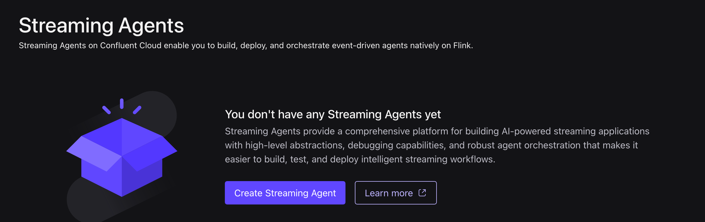</td>
</tr>
<tr>
<td>2. Open <b>Advanced configuration</b>, set Max iterations to <code>10</code>, and click <b>+ Add new tool</b>. Configure <code>lab3_remote_mcp</code> with <code>remote-mcp-connection</code> and enable only <code>http_get</code> and <code>http_post</code>.</td>
<td>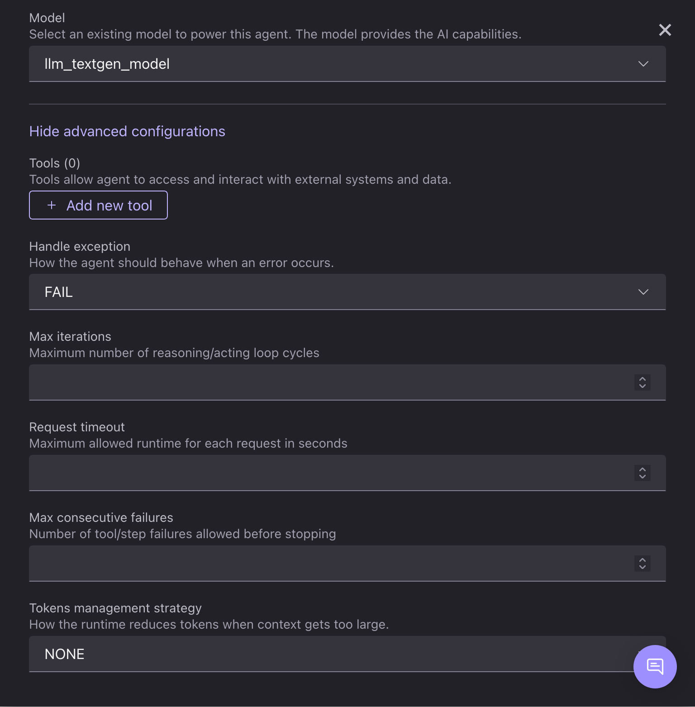</td>
</tr>
<tr>
<td>3. Confirm the tool was created and attach it to the agent.</td>
<td>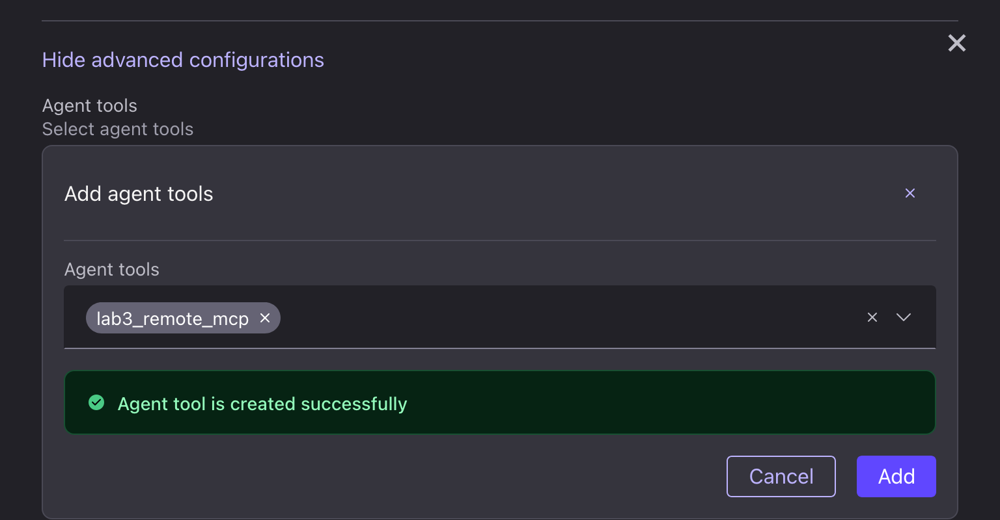</td>
</tr>
<tr>
<td>4. Review the configuration and click <b>Create agent</b>.</td>
<td>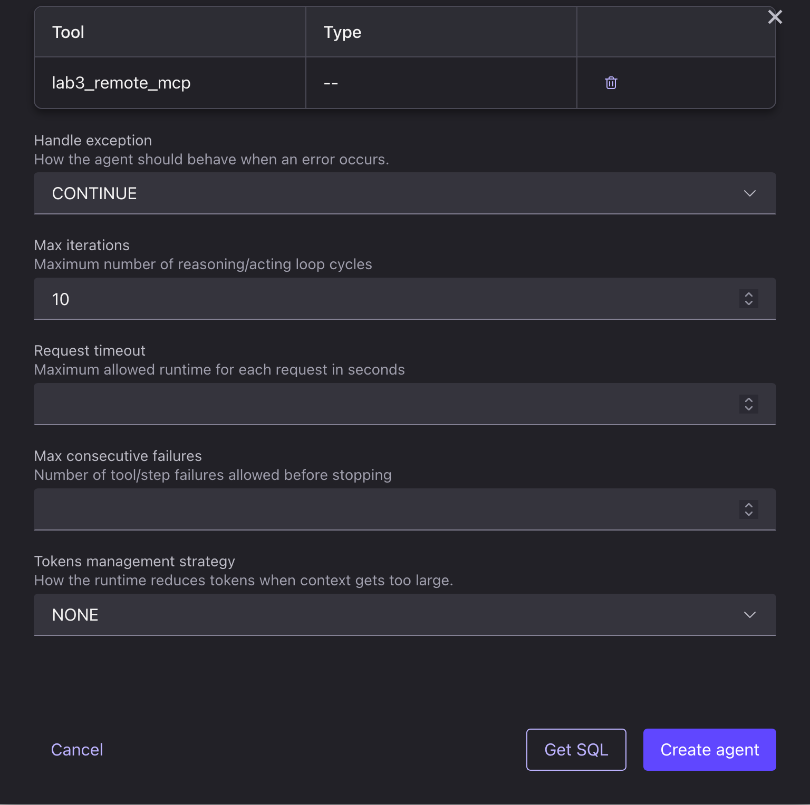</td>
</tr>
<tr>
<td>5. In the <b>Run</b> panel, replace the scaffolded SQL with the real <code>AI_RUN_AGENT</code> query from <a href="#4-invoke-the-agent-with-ai_run_agent">Step 4</a>.</td>
<td>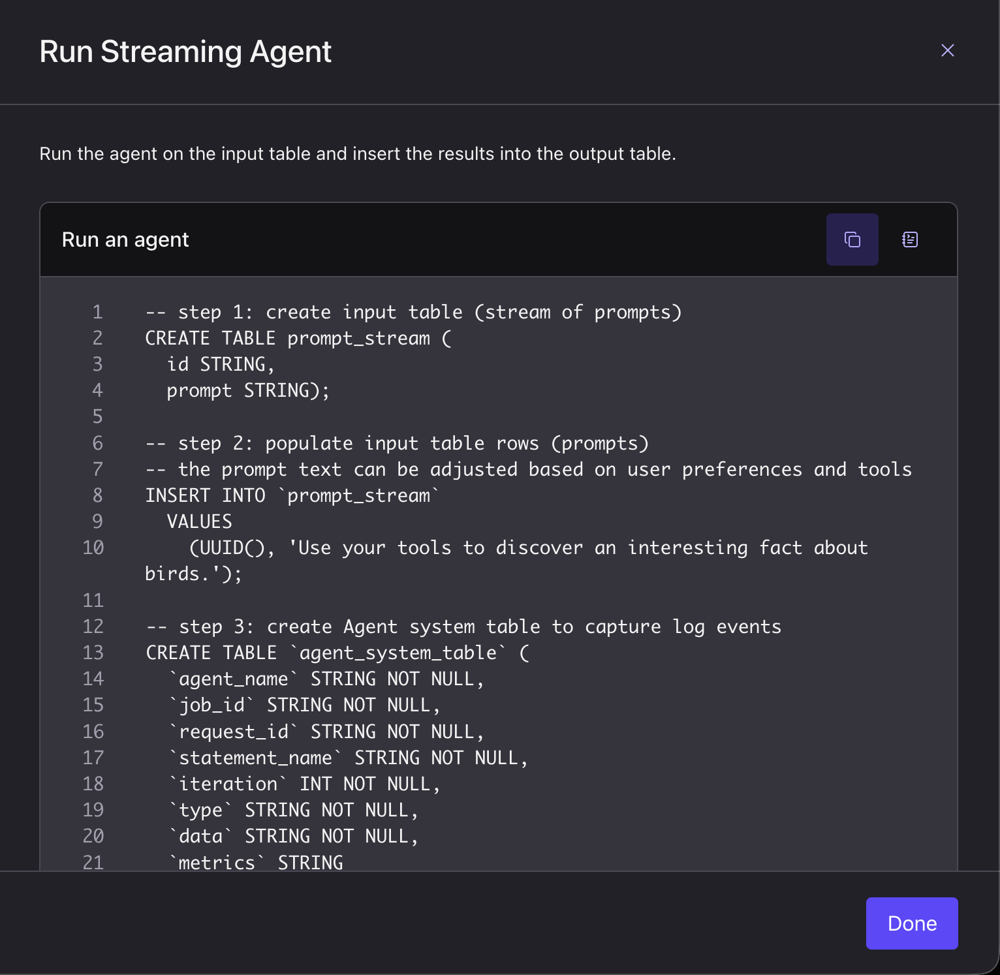</td>
</tr>
<tr>
<td>6. Run the statement in the <b>SQL Workspace</b> and confirm it is <b>Running</b> in the Activity tab and agent overview.</td>
<td>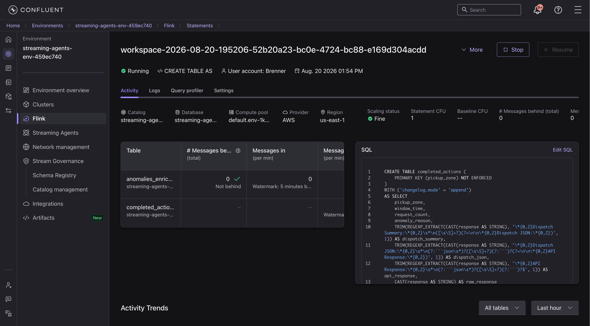<br>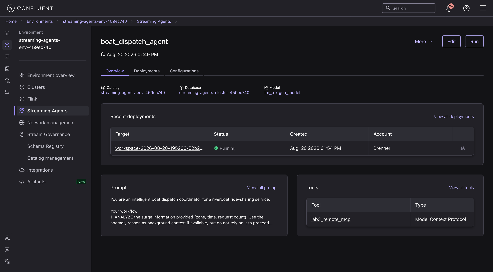</td>
</tr>
</table>

</details>

### 4. Invoke the agent with `AI_RUN_AGENT`

Run `CREATE TABLE completed_actions` using [`AI_RUN_AGENT`](https://docs.confluent.io/cloud/current/flink/reference/functions/model-inference-functions.html#flink-sql-ai-run-agent-function). The query passes a deterministic JSON payload (`zone`, `surge_time`, `request_count`, `expected_requests`, `anomaly_reason`) to the agent, parses the three labeled response sections using brace-aware JSON regexes, and retains `raw_response` as a fallback. The append table declares `pickup_zone` as a non-enforced key; it does not provide a unique ID for each dispatch or prevent repeated actions.

```sql
SET 'sql.local-time-zone' = 'America/Chicago';

CREATE TABLE completed_actions (
    PRIMARY KEY (pickup_zone) NOT ENFORCED
)
WITH ('changelog.mode' = 'append')
AS SELECT
    pickup_zone,
    window_time,
    request_count,
    anomaly_reason,
    TRIM(REGEXP_EXTRACT(CAST(response AS STRING), '(?s)Dispatch Summary:\*{0,2}\s*(.*?)(?=\s*(?:---\s*)?\*{0,2}Dispatch JSON:)', 1)) AS dispatch_summary,
    REGEXP_EXTRACT(CAST(response AS STRING), '(?s)Dispatch JSON:\*{0,2}\s*(?:```(?:json)?\s*)?(\{.*\})(?=\s*(?:```)?\s*(?:---\s*)?\*{0,2}API Response:)', 1) AS dispatch_json,
    REGEXP_EXTRACT(CAST(response AS STRING), '(?s)API Response:\*{0,2}\s*(?:```(?:json)?\s*)?(\{.*\})', 1) AS api_response,
    CAST(response AS STRING) AS raw_response
FROM anomalies_enriched,
LATERAL TABLE(AI_RUN_AGENT(
    `boat_dispatch_agent`,
    JSON_OBJECT(
        'zone' VALUE pickup_zone,
        'surge_time' VALUE CONCAT(
            DATE_FORMAT(window_time, 'yyyy-MM-dd h:mm a'), ' America/Chicago'
        ),
        'request_count' VALUE request_count,
        'expected_requests' VALUE expected_requests,
        'anomaly_reason' VALUE anomaly_reason
    ),
    `pickup_zone`
));
```

Inspect the agent output in a new cell:

```sql
SELECT pickup_zone, dispatch_summary, dispatch_json, api_response,
       dispatch_json IS JSON OBJECT AS valid_dispatch_json,
       api_response IS JSON OBJECT AS valid_api_json
FROM completed_actions;
```

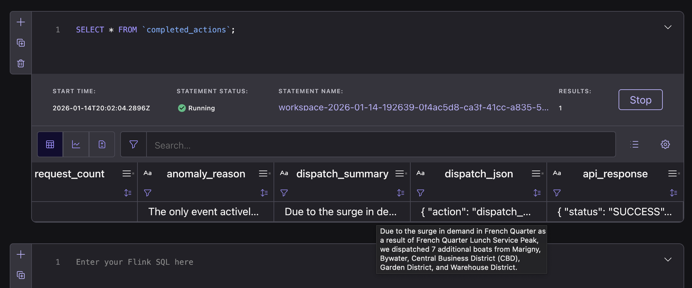

Because the remote fleet backend is shared across workshop participants, the exact vessels selected and remaining availability will vary. Before concluding that vessels were dispatched, verify that `dispatch_summary`, `dispatch_json`, and `api_response` are non-empty, `dispatch_json IS JSON OBJECT`, `api_response IS JSON OBJECT`, and `api_response` reports `"status":"SUCCESS"`. If a model formats sections unexpectedly, inspect `raw_response` rather than re-running the query (which would issue duplicate `http_post` dispatches).

### Stop Lab 3 statements before Lab 4

Once you have verified `completed_actions`, **stop** your preview `SELECT` queries and the three continuous writers (`completed_actions`, `anomalies_enriched`, `anomalies_per_zone`) in the SQL Workspace to release compute pool capacity for Lab 4.

## Troubleshooting
<details>
<summary>Click to expand</summary>

- **No rows appearing or query stuck in `PENDING` / `POOL_EXHAUSTED`?**
  - Check **Flink Statements → Exceptions / Activity** and your compute pool capacity. Stop any finished or unused `SELECT` preview queries so the three continuous `CREATE TABLE` jobs have CFU slots. Also ensure `uv run lab3_datagen --local` ran once.
- **Error on Query #1:** `The window function requires the timecol is a time attribute type, but is TIMESTAMP_WITH_LOCAL_TIME_ZONE(3).`
  - Happens if `ride_requests` was recreated without a watermark definition. Restore the watermark and retry:
```sql no-parse
ALTER TABLE ride_requests
MODIFY (WATERMARK FOR request_ts AS request_ts - INTERVAL '5' SECOND);
```
- **Degraded or Stopped Flink statement?**
  - An active anomaly detection job may show degraded when idle and recover when data flows, whereas a statement that was manually **Stopped** must be explicitly **Resumed** in the UI.
- **`Runtime received bad response code 403` error?**
  - Check statement exceptions for the failing endpoint or model. If you deployed with `--bedrock`, ensure Claude Sonnet 4.5 is enabled in AWS Bedrock ([Prerequisites](#prerequisites)). If you deployed with `--azure-openai`, increase the TPM quota on your `gpt-5-mini` deployment.

</details>

## 🧹 Clean-up

> [!WARNING]
> **Continuing to Lab 4?** Do **not** run `uv run destroy` yet. It tears down **all four labs and shared core infrastructure**. Only stop your Lab 3 Flink statements above, then proceed to Lab 4.

When you have finished **all** labs in the workshop, remove all cloud resources with:

```bash
uv run destroy
```

## Navigation

- **← Back to Overview**: [Main README](./README.md)
- **← Previous Lab**: [Lab2: Vector Search & RAG](./LAB2-Walkthrough.md)
- **→ Next Lab**: [Lab4: Disaster Relief Claim Review](./LAB4-Walkthrough.md)
- **🧹 Cleanup**: [Cleanup Instructions](./README.md#cleanup)
