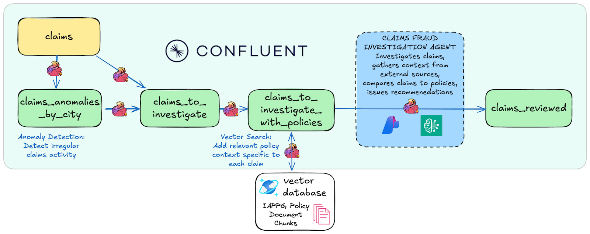
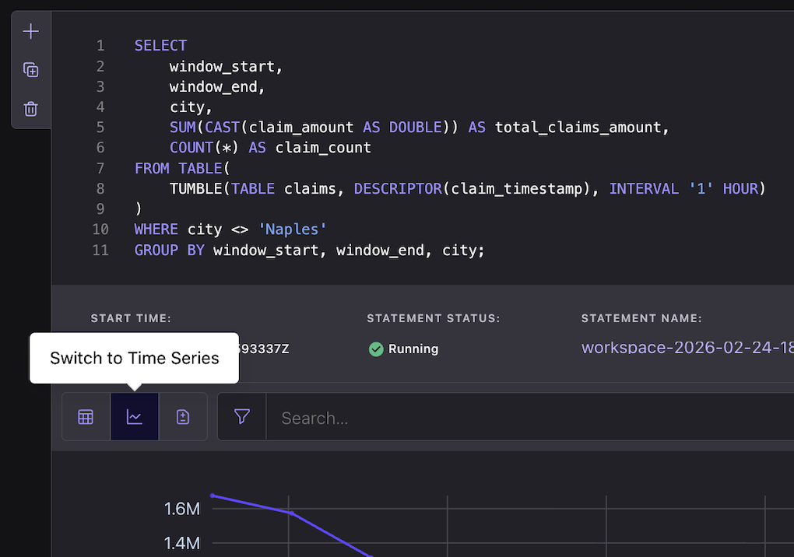
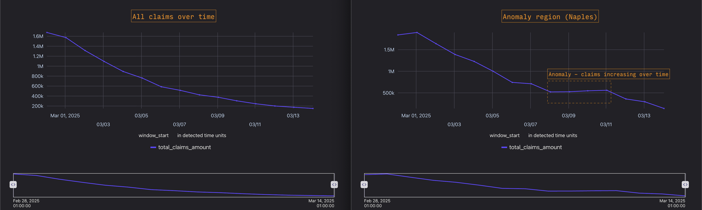
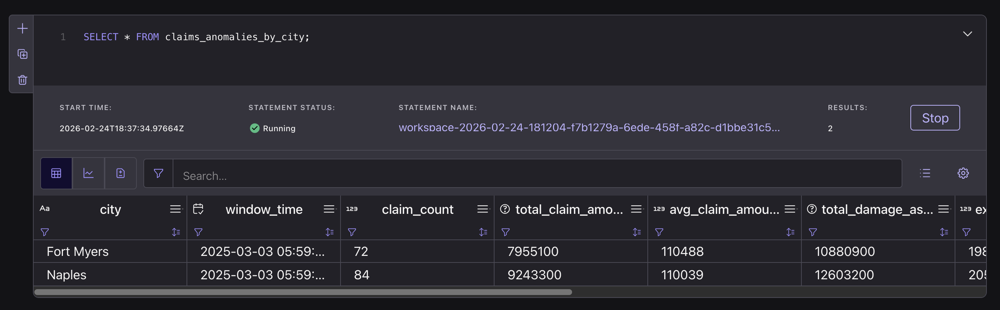
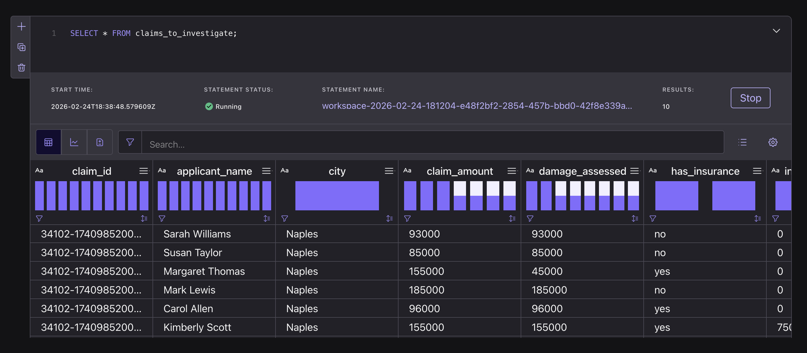
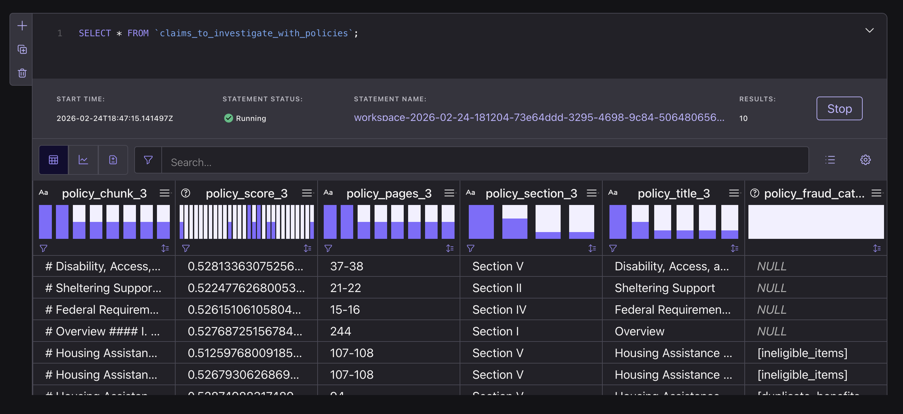
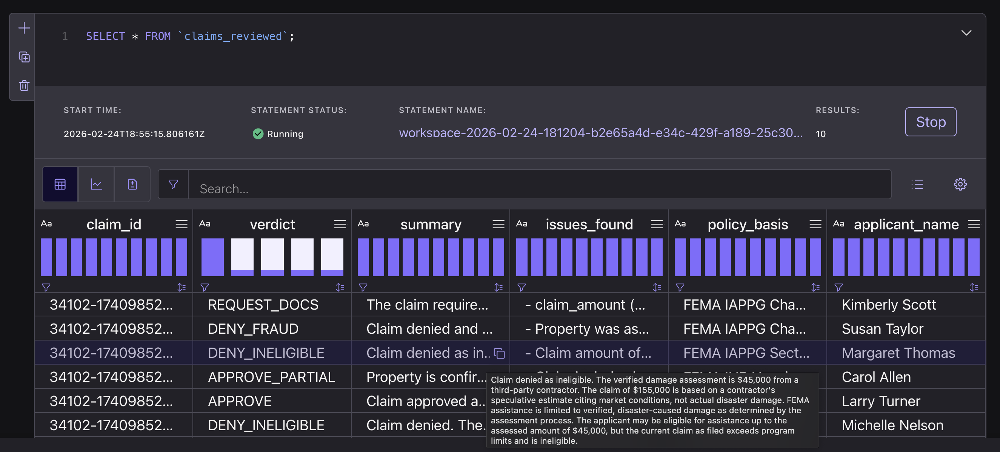

# Lab 4: Public Sector Disaster Claim Screening Using Confluent Intelligence



Use [Confluent Intelligence](https://www.confluent.io/product/confluent-intelligence/) to screen synthetic FEMA Individuals and Households Program (IHP) applications. Detect city-level surges in claim dollars, retrieve policy passages with vector search, and ask a Flink SQL agent to review a sample of individual claims.

The output is a proposed review of each sampled claim. Use the retrieved passages and original claim to assess the agent’s reasoning.

---

## Prerequisites

> [!TIP]
> **Already deployed?** If you are in an instructor-led workshop or already ran `uv run deploy` for Lab 4, skip to [Open the Flink Workspace and Verify Resources](#open-the-flink-workspace-and-verify-resources).

### Local dependencies

**macOS:**

```bash
brew install uv git python && brew tap hashicorp/tap && brew install hashicorp/tap/terraform && brew install --cask confluent-cli
```

**Windows:**

```powershell
winget install astral-sh.uv Git.Git Hashicorp.Terraform ConfluentInc.Confluent-CLI Python.Python
```

### API keys and model access

> [!NOTE]
> Credentials are provided for you in instructor-led workshops.

- **Default LLM access (no keys required):** `uv run deploy` configures **CSP Hosted model inference** by default (AWS: Claude Sonnet 4.6 and Titan Text Embeddings v2; Azure: GPT-5.4 mini and text-embedding-3-small) without external cloud or LLM API keys.
- **Optional custom model providers:** Run `uv run deploy --bedrock` (AWS Bedrock) or `uv run deploy --azure-openai` (Azure OpenAI) to use your own model credentials.

---

## Deploy Lab 4

Clone the repository if needed:

```bash
git clone https://github.com/confluentinc/quickstart-streaming-agents.git
cd quickstart-streaming-agents
```

Run the deployment script and select **Lab 4: FEMA Fraud Detection**:

```bash
uv run deploy
```

The script prompts for Confluent Cloud credentials, plus AWS Bedrock or Azure OpenAI credentials only if you passed `--bedrock` or `--azure-openai`.

---

## Open the Flink Workspace and Verify Resources

1. Generate the core deployment summary to view your Confluent Cloud selector names and IDs:

```bash
uv run deployment-summary core
```

2. Open the [Confluent Cloud Flink UI](https://confluent.cloud/go/flink) and select the **Environment**, **Database (Kafka cluster)**, and **Compute Pool** shown in your `uv run deployment-summary core` output.
3. In a SQL cell, verify the provisioned base tables:

```sql
SHOW TABLES;
```

Confirm both tables exist: `claims` and `fema_policies_vectordb`.

4. In another SQL cell, verify the AI models:

```sql
SHOW MODELS;
```

Confirm both models exist: `llm_textgen_model` and `llm_embedding_model`.

### How to manage Flink statements in this lab

- **Keep streaming writers running while active:** Each `CREATE TABLE ... AS SELECT` statement is a streaming job. Note that `claims_to_investigate` uses `LIMIT 10` on a finite dataset and may transition to **Completed** once its sample is written.
- **Stop read-only `SELECT` queries after inspection:** Interactive `SELECT` queries consume shared compute pool capacity while open. Click **Stop** on each `SELECT` cell once you verify its output.
- **Keep `SET` and `CREATE TABLE` in the same cell:** In the Confluent Cloud Flink UI, `SET` cannot run as a standalone cell, so run `SET 'sql.state-ttl' = '14 d';` and the following `CREATE TABLE` statement together in the same cell (REST API and CLI users pass `'sql.state-ttl' = '14 d'` as a statement property).

---

## Understand the Synthetic Dataset

During deployment, the Lab 4 data generator publishes a finite backfill of **33,984** (`~34,000`) synthetic claims across **8 Florida cities** into `claims`. Meanwhile, `fema_policies_vectordb` is a pre-populated external table containing FEMA Individual Assistance Program and Policy Guide (IAPPG) policy chunks and embeddings.

- **Timestamp rebasing:** The generator rebases `claim_timestamp` across the **trailing 14 days** up to deployment time so time-windowed Flink queries run immediately. Other fields (`disaster_date`, `assessment_date`, and Hurricane Helene references) remain static synthetic context and do not imply a storm occurred 14 days ago.
- **City-level pattern:** Seven cities follow a post-disaster exponential decay across the 14 days. **Naples** follows the same decay for 12 days before surging during the **final 2 days (Days 13–14)** with claims containing ineligible expenses, policy violations, and fraud indicators.

---

## Use Case Walkthrough

### Step 0: Visualize Claim Volume and Dollars by City

Aggregate `claims` into **1-hour tumbling windows** to compare the 14-day city trends in the [Flink UI](https://confluent.cloud/go/flink).

Run this query for all cities except Naples:

```sql
SELECT
    window_start,
    window_end,
    city,
    SUM(CAST(claim_amount AS DOUBLE)) AS total_claims_amount,
    COUNT(*) AS claim_count
FROM TABLE(
    TUMBLE(TABLE claims, DESCRIPTOR(claim_timestamp), INTERVAL '1' HOUR))
WHERE city <> 'Naples'
GROUP BY window_start, window_end, city;
```

In a second cell, query Naples alone:

```sql
SELECT
    window_start,
    window_end,
    SUM(CAST(claim_amount AS DOUBLE)) AS total_claims_amount,
    COUNT(*) AS claim_count
FROM TABLE(
    TUMBLE(TABLE claims, DESCRIPTOR(claim_timestamp), INTERVAL '1' HOUR))
WHERE city = 'Naples'
GROUP BY window_start, window_end;
```

Click **Switch to Time Series** in each result pane. Set the time axis to `window_start`, the value to `total_claims_amount`, and group the first chart by `city`. Zoom to the final two days to inspect the Naples surge. The one-hour charts show detail; the six-hour detector below uses a smoother baseline.





*Illustrative output: Seven cities decaying steadily versus the late surge in Naples.*

Stop both `SELECT` queries when finished.

---

### Step 1: Detect City-Level Claim Spikes Using `ML_DETECT_ANOMALIES`

The automated detector aggregates claims into **6-hour tumbling windows** per city and runs `ML_DETECT_ANOMALIES` over summed claim dollars (`SUM(claim_amount)` as `total_claim_amount`) rather than claim count alone.

Key settings:
- **`minTrainingSize: 8`** requires 8 six-hour windows (**2 days of event-time history**) per city before scoring. Because `claims` already holds a 14-day event-time backfill, Flink can process that history without a two-day wall-clock wait.
- **`maxTrainingSize: 50`** limits the training history to 50 windows per city.
- **`confidencePercentage: 95.0`** and **`enableStl: FALSE`** flag windows where `total_claim_amount` exceeds the 95% confidence upper bound without seasonal decomposition.

See the [anomaly detection guide](https://docs.confluent.io/cloud/current/ai/builtin-functions/detect-anomalies.html) and [Flink SQL `ML_DETECT_ANOMALIES` reference](https://docs.confluent.io/cloud/current/flink/reference/functions/model-inference-functions.html#flink-sql-ml-anomaly-detect-function).

Run this writer statement:

```sql
SET 'sql.state-ttl' = '14 d';

CREATE TABLE claims_anomalies_by_city AS
WITH windowed_claims AS (
    SELECT
        window_start,
        window_end,
        window_time,
        city,
        COUNT(*) AS claim_count,
        SUM(CAST(claim_amount AS DOUBLE)) AS total_claim_amount,
        CAST(ROUND(AVG(CAST(claim_amount AS DOUBLE))) AS BIGINT) AS avg_claim_amount,
        SUM(CAST(damage_assessed AS DOUBLE)) AS total_damage_assessed
    FROM TABLE(
        TUMBLE(TABLE claims, DESCRIPTOR(claim_timestamp), INTERVAL '6' HOUR)
    )
    GROUP BY window_start, window_end, window_time, city
),
anomaly_detection AS (
    SELECT
        city,
        window_time,
        claim_count,
        total_claim_amount,
        avg_claim_amount,
        total_damage_assessed,
        ML_DETECT_ANOMALIES(
            CAST(total_claim_amount AS DOUBLE),
            window_time,
            JSON_OBJECT(
                'minTrainingSize' VALUE 8,
                'maxTrainingSize' VALUE 50,
                'confidencePercentage' VALUE 95.0,
                'enableStl' VALUE FALSE
            )
        ) OVER (
            PARTITION BY city
            ORDER BY window_time
            RANGE BETWEEN UNBOUNDED PRECEDING AND CURRENT ROW
        ) AS anomaly_result
    FROM windowed_claims
)
SELECT
    city,
    window_time,
    claim_count,
    total_claim_amount,
    avg_claim_amount,
    total_damage_assessed,
    CAST(ROUND(anomaly_result.forecast_value) AS BIGINT) AS expected_claim_amount,
    anomaly_result.upper_bound AS upper_bound,
    anomaly_result.lower_bound AS lower_bound,
    anomaly_result.is_anomaly AS is_anomaly
FROM anomaly_detection
WHERE anomaly_result.is_anomaly = true
  AND total_claim_amount > anomaly_result.upper_bound;
```

#### Checkpoint: Inspect detected anomaly windows

In a separate cell, query the anomaly table:

```sql
SELECT * FROM claims_anomalies_by_city;
```

Confirm that at least one Naples window appears where `total_claim_amount` exceeds `upper_bound` (exact window counts can vary slightly with timestamp alignment):



Stop the `SELECT` query after verifying.

---

### Step 2: Isolate Narrative Claims and Retrieve FEMA Policy Context

#### 2a. Shortlist claims from the anomaly window

`claims_to_investigate` joins claims to their city’s flagged six-hour window and selects **up to 10 claims with narratives**. The limit bounds inference costs; there is no guaranteed row order. A verified AWS run found **6 matching claims**, so fewer than 10 rows is normal. This is a bounded workshop sample.

Run this writer statement:

```sql
SET 'sql.state-ttl' = '14 d';

CREATE TABLE claims_to_investigate AS
SELECT
    c.claim_id,
    c.applicant_name,
    c.city,
    c.claim_narrative,
    c.claim_amount,
    c.damage_assessed,
    c.has_insurance,
    c.insurance_amount,
    c.is_primary_residence,
    c.assessment_date,
    c.disaster_date,
    c.assessment_source,
    c.shared_account,
    c.shared_phone,
    c.previous_claims_count,
    c.last_claim_date,
    c.claim_timestamp,
    a.window_time AS anomaly_window_time,
    a.total_claim_amount AS anomaly_total_amount,
    a.is_anomaly
FROM claims c
INNER JOIN claims_anomalies_by_city a
    ON c.city = a.city
    AND c.claim_timestamp >= a.window_time - INTERVAL '6' HOUR
    AND c.claim_timestamp <= a.window_time
WHERE c.claim_narrative <> ''
LIMIT 10;
```

#### Checkpoint: Inspect the shortlisted claims

Query the shortlisted claims in a separate cell:

```sql
SELECT claim_id, city, claim_amount, claim_narrative FROM claims_to_investigate;
```



Stop the `SELECT` query once rows appear.

#### 2b. Retrieve FEMA policy context with vector search

`claims_to_investigate_with_policies` embeds each narrative and retrieves the three closest FEMA policy passages with their source metadata and similarity scores.

Run this writer statement:

```sql
SET 'sql.state-ttl' = '14 d';

  CREATE TABLE claims_to_investigate_with_policies AS                 
  WITH embedded AS (                                                   
      SELECT
          c.*,
          e.embedding AS narrative_embedding
      FROM claims_to_investigate c,
      LATERAL TABLE(ML_PREDICT('llm_embedding_model', c.claim_narrative)) e
  )
  SELECT
      c.claim_id,
      c.applicant_name,
      c.city,
      c.claim_amount,
      c.damage_assessed,
      c.has_insurance,
      c.insurance_amount,
      c.is_primary_residence,
      c.claim_narrative,
      c.assessment_date,
      c.disaster_date,
      c.assessment_source,
      c.shared_account,
      c.shared_phone,
      c.previous_claims_count,
      c.last_claim_date,
      c.claim_timestamp,
      c.anomaly_window_time,
      c.anomaly_total_amount,
      c.is_anomaly,
      vs.search_results[1].chunk AS policy_chunk_1,
      vs.search_results[1].score AS policy_score_1,
      vs.search_results[1].pages AS policy_pages_1,
      vs.search_results[1].section_reference AS policy_section_1,
      vs.search_results[1].title AS policy_title_1,
      vs.search_results[1].fraud_categories AS policy_fraud_cats_1,
      vs.search_results[1].policy_keywords AS policy_keywords_1,
      vs.search_results[2].chunk AS policy_chunk_2,
      vs.search_results[2].score AS policy_score_2,
      vs.search_results[2].pages AS policy_pages_2,
      vs.search_results[2].section_reference AS policy_section_2,
      vs.search_results[2].title AS policy_title_2,
      vs.search_results[2].fraud_categories AS policy_fraud_cats_2,
      vs.search_results[2].policy_keywords AS policy_keywords_2,
      vs.search_results[3].chunk AS policy_chunk_3,
      vs.search_results[3].score AS policy_score_3,
      vs.search_results[3].pages AS policy_pages_3,
      vs.search_results[3].section_reference AS policy_section_3,
      vs.search_results[3].title AS policy_title_3,
      vs.search_results[3].fraud_categories AS policy_fraud_cats_3,
      vs.search_results[3].policy_keywords AS policy_keywords_3
  FROM embedded c,
  LATERAL TABLE(
      VECTOR_SEARCH_AGG(
          fema_policies_vectordb,
          DESCRIPTOR(embedding),
          c.narrative_embedding,
          3
      )
  ) vs;
```

#### Checkpoint: Inspect retrieved policy chunks

Verify that policy metadata and chunks are populated for each shortlisted claim:

```sql
SELECT claim_id, policy_title_1, policy_section_1, policy_score_1, policy_chunk_1 FROM claims_to_investigate_with_policies;
```



Stop the `SELECT` query after verifying.

---

### Step 3: Define the Claim Screening Agent

The agent compares claim and insurance amounts, checks narrative consistency and cites retrieved policy passages. Its prompt specifies a nine-point checklist and four output labels for parsing. See the [CREATE AGENT documentation](https://docs.confluent.io/cloud/current/flink/reference/statements/create-agent.html).

Run this statement in a new cell:

```sql
CREATE AGENT `claims_fraud_investigation_agent`
USING MODEL `llm_textgen_model`
USING PROMPT 'OUTPUT RULES — read before anything else:
1. Respond with ONLY these four labeled sections, in this exact order:
   Verdict:
   Issues Found:
   Policy Basis:
   Summary:
2. NO markdown. No asterisks, no bold, no headers, no pound signs. Plain text only.
3. The Verdict line must contain exactly one word: APPROVE, APPROVE_PARTIAL, REQUEST_DOCS, DENY_INELIGIBLE, or DENY_FRAUD.

Correct format example:
Verdict: DENY_INELIGIBLE

Issues Found:
- Property is not a primary residence. Narrative states "our Naples beach house we rent out seasonally."
- is_primary_residence = "no" confirmed in structured data.

Policy Basis:
FEMA IAPPG Section 3 — IHP Housing Assistance is restricted to the applicants primary dwelling. Rental and vacation properties are categorically excluded.

Summary:
Claim denied. The property is a seasonal rental, not a primary residence, and is therefore ineligible for IHP assistance regardless of the damage amount.

---

You are a FEMA IHP fraud detection agent reviewing Hurricane Helene disaster assistance claims.

CHECKLIST — evaluate all nine in order:

1. CLAIM CEILING: Does claim_amount > damage_assessed? Auto-violation — FEMA cannot pay above verified assessed damage.
2. DUPLICATION OF BENEFITS: Does claim_amount > (damage_assessed minus insurance_amount)? FEMA covers only the uncompensated gap.
3. PRIMARY RESIDENCE: Is is_primary_residence = "no"? IHP covers primary dwellings only — vacation homes, investment properties, and rentals are ineligible.
4. ASSESSMENT SOURCE: Is assessment_source = "Self"? Self-assessments are not accepted. Flag if narrative claims a "FEMA inspection" but source = "Contractor".
5. PROPERTY USE (narrative): Does the narrative reveal a vacation rental, second home, or income-producing property?
6. INELIGIBLE ITEMS (narrative): Does the narrative claim pools, boats, landscaping, fences, outdoor furniture, or other non-essential property?
7. PRE-EXISTING DAMAGE (narrative): Does the narrative disclose wear, deterioration, or damage that predates the disaster?
8. EXPLICIT DUPLICATION (narrative): Does the narrative admit receiving insurance payment for the same damage while also claiming FEMA funds?
9. PRIOR CLAIMS: Does previous_claims_count > 0? Weight more heavily when combined with other violations.

VERDICTS:
- APPROVE: All checks pass, claim eligible as submitted.
- APPROVE_PARTIAL: Property is eligible and damage is verified, but the claim amount exceeds the allowable ceiling or includes specific ineligible items. Approve the eligible portion. State the calculated eligible amount in Issues Found (e.g., "Eligible amount: $45,000 (damage_assessed ceiling)").
- REQUEST_DOCS: No clear violation, but a determination requires additional documentation before a final decision.
- DENY_INELIGIBLE: Property or claim is categorically ineligible regardless of amount — non-primary residence declared in structured data, vacation rental or income-producing property revealed in narrative, or self-assessment with no third-party verification. No portion is approvable.
- DENY_FRAUD: Deliberate misrepresentation — false primary residence claim, explicit insurance duplication, or mathematically impossible amounts. Refer to OIG.

In Issues Found: cite dollar amounts and quote key phrases from the narrative. For APPROVE_PARTIAL, state the eligible amount. Write "None — claim passes all checks." if APPROVE.
In Policy Basis: cite specific section titles and references from the retrieved FEMA policy chunks.

REMINDER: Plain text only. No asterisks, no bold, no markdown of any kind.'
WITH (
  'max_iterations' = '10'
);
```

---

### Step 4: Run the Agent on Shortlisted Claims

Invoke the agent on the policy-enriched shortlist and parse its labeled response into columns, retaining `raw_response` for inspection. See the [`AI_RUN_AGENT` documentation](https://docs.confluent.io/cloud/current/flink/reference/functions/model-inference-functions.html#flink-sql-ai-run-agent-function).

Run this writer statement:

```sql
SET 'sql.state-ttl' = '14 d';

CREATE TABLE claims_reviewed (
    PRIMARY KEY (claim_id) NOT ENFORCED
)
WITH ('changelog.mode' = 'append')
AS SELECT
    claim_id,
    TRIM(REGEXP_EXTRACT(CAST(response AS STRING), '\*{0,2}Verdict:\*{0,2}\s*([A-Z_]+)', 1)) AS verdict,
    TRIM(REGEXP_EXTRACT(CAST(response AS STRING), '\*{0,2}Summary:\*{0,2}\n([\s\S]+?)$', 1)) AS summary,
    TRIM(REGEXP_EXTRACT(CAST(response AS STRING), '\*{0,2}Issues Found:\*{0,2}\n([\s\S]+?)(?=\n\*{0,2}(?:Policy Basis|Summary|Verdict):|$)', 1)) AS issues_found,
    TRIM(REGEXP_EXTRACT(CAST(response AS STRING), '\*{0,2}Policy Basis:\*{0,2}\n([\s\S]+?)(?=\n\*{0,2}(?:Summary|Verdict):|$)', 1)) AS policy_basis,
    applicant_name,
    claim_narrative,
    claim_amount,
    damage_assessed,
    insurance_amount,
    is_primary_residence,
    assessment_source,
    previous_claims_count,
    CAST(response AS STRING) AS raw_response
FROM claims_to_investigate_with_policies,
LATERAL TABLE(AI_RUN_AGENT(
    `claims_fraud_investigation_agent`,
    CONCAT(
        'CLAIM FOR REVIEW: ', claim_id, '\n',
        'Applicant: ', applicant_name, '\n',
        'Claim Amount: $', claim_amount, '\n',
        'Total Damage Assessed: $', COALESCE(CAST(damage_assessed AS STRING), '0'), '\n',
        'Insurance Payout: $', COALESCE(CAST(insurance_amount AS STRING), '0'), '\n',
        'Uncompensated Gap (damage minus insurance): $',
            CAST(CAST(
                COALESCE(CAST(damage_assessed AS DOUBLE), 0.0) -
                COALESCE(CAST(insurance_amount AS DOUBLE), 0.0)
            AS BIGINT) AS STRING), '\n',
        'Is Primary Residence: ', COALESCE(is_primary_residence, 'unknown'), '\n',
        'Assessment Source: ', COALESCE(assessment_source, 'unknown'), '\n',
        'Prior FEMA Claims: ', COALESCE(CAST(previous_claims_count AS STRING), '0'), '\n',
        '\nCLAIM NARRATIVE:\n', COALESCE(claim_narrative, '(none)'), '\n',
        '\nRETRIEVED FEMA POLICY SECTIONS:\n',
        '1. ', COALESCE(policy_title_1, 'N/A'), ' (', COALESCE(policy_section_1, 'N/A'), '):\n',
        COALESCE(policy_chunk_1, ''), '\n\n',
        '2. ', COALESCE(policy_title_2, 'N/A'), ' (', COALESCE(policy_section_2, 'N/A'), '):\n',
        COALESCE(policy_chunk_2, ''), '\n\n',
        '3. ', COALESCE(policy_title_3, 'N/A'), ' (', COALESCE(policy_section_3, 'N/A'), '):\n',
        COALESCE(policy_chunk_3, '')
    ),
    MAP['debug', 'true']
));
```

#### Checkpoint: Inspect verdicts and summaries

LLM inference runs asynchronously per row. Query `claims_reviewed` to view the results as they arrive:

```sql
SELECT claim_id, verdict, summary FROM claims_reviewed;
```

The verified AWS sample produced four `APPROVE_PARTIAL` and two `DENY_INELIGIBLE` verdicts. Outputs can vary by model and run:



*This earlier screenshot shows different rows and verdicts. Your sample may contain fewer rows. Click a truncated cell to read its full text.*

#### Validate parsed agent fields

A **Running** statement status does not guarantee every LLM response matched the regex headers. Run this validation query once `claims_reviewed` populates:

```sql
SELECT claim_id, verdict, raw_response
FROM claims_reviewed
WHERE verdict IS NULL
   OR verdict NOT IN ('APPROVE', 'APPROVE_PARTIAL', 'REQUEST_DOCS', 'DENY_INELIGIBLE', 'DENY_FRAUD')
   OR COALESCE(TRIM(summary), '') = ''
   OR COALESCE(TRIM(issues_found), '') = ''
   OR COALESCE(TRIM(policy_basis), '') = '';
```

- **Expected result:** **0 rows**, confirming every row has a valid verdict code and non-empty parsed fields.
- **If rows appear:** Inspect `raw_response` for that `claim_id` to see how the model output deviated from the prompt format.

#### Worked example: Inspecting claim `34102-03732`

Inspect synthetic claim `34102-03732` (Sarah Williams):

```sql
SELECT claim_id, issues_found, policy_basis, raw_response FROM claims_reviewed WHERE claim_id = '34102-03732';
```


*Observed synthetic example (`34102-03732`): The applicant claimed `$93,000` (`$75,000` pool damage + `$18,000` roof damage); the agent flagged the `$75,000` pool expense as ineligible (`$93,000 - $75,000 = $18,000`) and proposed `APPROVE_PARTIAL` for the remaining `$18,000`. This illustrates agent output on synthetic data, not an independent legal adjudication of FEMA eligibility.*

Stop your open `SELECT` queries once you finish inspecting the results.

---

## Lab Completion Checklist

- [ ] `claims_anomalies_by_city` is **Running** and outputs at least one Naples anomaly row (`total_claim_amount > upper_bound`).
- [ ] `claims_to_investigate` is **Running** (or **Completed** after reaching its finite limit) and contains up to 10 shortlisted narrative claims (6 in the verified AWS run).
- [ ] `claims_to_investigate_with_policies` is **Running** and populates `policy_title_1`, `policy_section_1`, `policy_score_1`, and `policy_chunk_1`.
- [ ] `claims_reviewed` is **Running** and populates `verdict`, `summary`, `issues_found`, `policy_basis`, and `raw_response`, with the validation query returning 0 rows.

---

## Troubleshooting

<details>
<summary>Click to expand troubleshooting checks</summary>

### 1. Check base tables and Terraform outputs

Only `claims` and `fema_policies_vectordb` are provisioned by Terraform; all downstream tables are created in the Flink UI.

Verify `claims` holds its finite backfill (`33,984` rows, or `~34,000`), then stop the query:

```sql
SELECT COUNT(*) FROM claims;
```

Check the Lab 4 Terraform outputs from your terminal:

```bash
terraform -chdir=terraform/lab4-pubsec-fraud-agents output
```

Confirm that `claims_table_statement_id`, `claims_table_name`, and `lab4_deployment_status` are present.

### 2. Table or Agent already exists (or does not exist)

- **`Table '...' does not exist`:** Confirm the upstream `CREATE TABLE` statement was executed in the same environment/database and is running (or completed for `claims_to_investigate`).
- **`Table '...' already exists` or `Agent '...' already exists`:** Do not drop `claims` or `fema_policies_vectordb` or blindly re-run `CREATE TABLE`. Check **Statements** in the Flink UI—existing table data remains retained in Kafka, so you can resume or query existing tables directly.

### 3. Compute pool exhausted or statements stuck in `PENDING`

- Open **Statements** in the Flink UI and **Stop** any open `SELECT` queries from earlier steps or labs.
- Do not alter `ML_DETECT_ANOMALIES` parameters or model definitions to work around compute pool capacity.

### 4. Model inference errors on `claims_to_investigate_with_policies` or `claims_reviewed`

- Check the statement's **Exceptions** tab in the Flink UI and run `SHOW MODELS;` to confirm `llm_embedding_model` and `llm_textgen_model` exist.
- **Default CSP Hosted models:** No external LLM keys are used; if you hit regional quota or throttling errors, wait briefly or contact your instructor.
- **Custom `--bedrock` or `--azure-openai` deployments:** Verify the cloud credentials or endpoint provided during `uv run deploy`.

### 5. Resuming work vs. resetting data

Resume existing statements to continue with retained data; do not re-publish as a routine recovery step. `uv run lab4_datagen` deletes retained records from `claims`, `claims_anomalies_by_city`, `claims_to_investigate`, `claims_to_investigate_with_policies`, and `claims_reviewed`. It does not reset the state already held by Flink jobs. For a deliberate clean repeat, save needed results, stop the affected statements, and coordinate the input and state reset with your instructor.

</details>

---

## Clean Up

### Routine per-lab finish (keep your environment for other labs)

1. In the Flink UI, **Stop** your open `SELECT` queries and Lab 4 `CREATE TABLE` writer statements to free compute pool capacity.
2. Leave the tables and agent in place (stopping statements halts compute but leaves existing table data intact).

### Full environment teardown (only after finishing all labs)

> [!WARNING]
> `uv run destroy` tears down **all 4 labs and shared core Confluent Cloud infrastructure**. Run this command **only** after finishing all labs in this environment.

```bash
uv run destroy
```

---

## Navigation

- **← Back to Overview**: [Main README](./README.md)
- **← Previous Lab**: [Lab3: Agentic Fleet Management](./LAB3-Walkthrough.md)
- **🧹 Cleanup**: [Cleanup Instructions](./README.md#cleanup)
